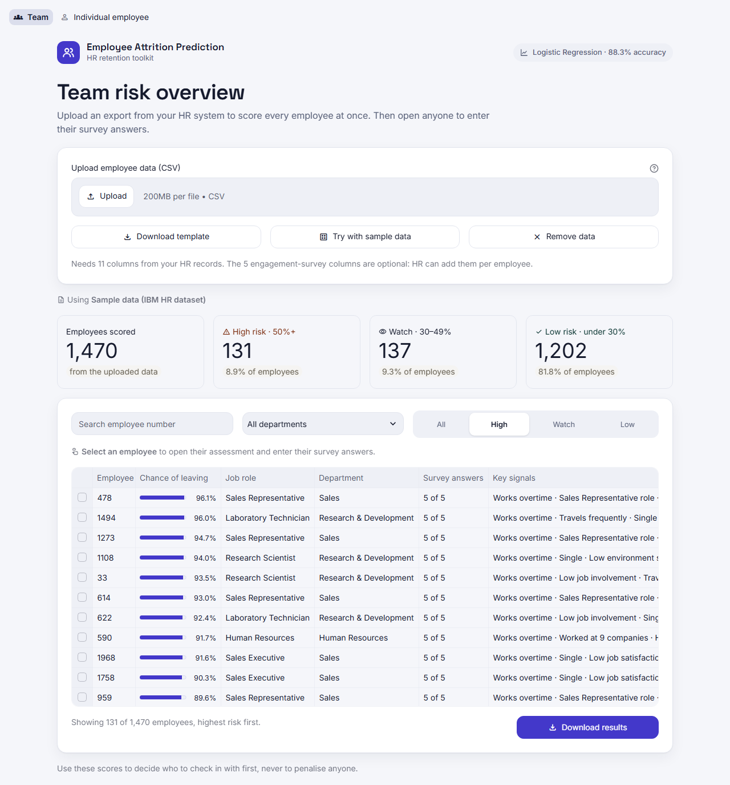
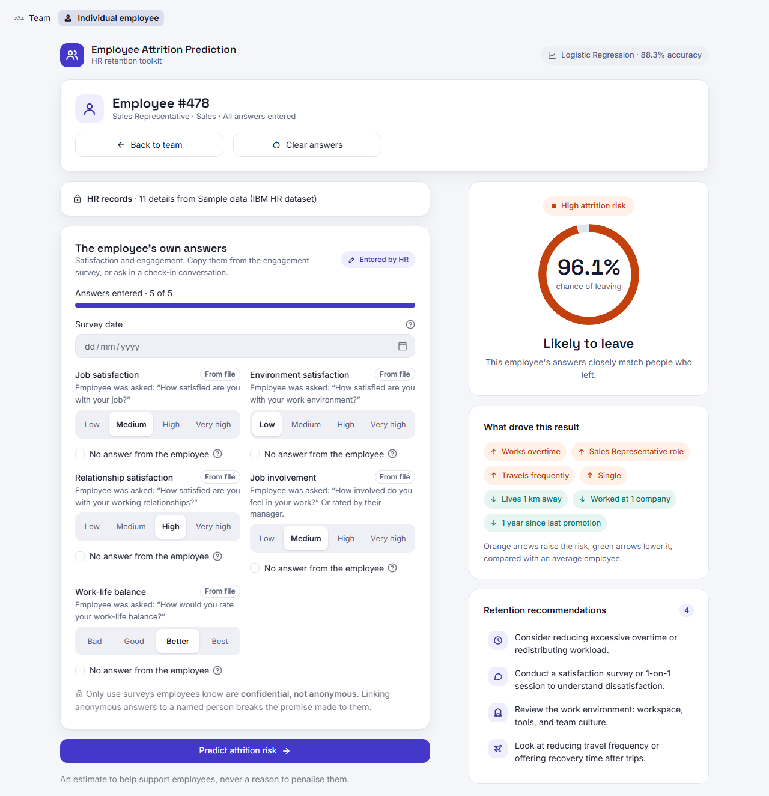
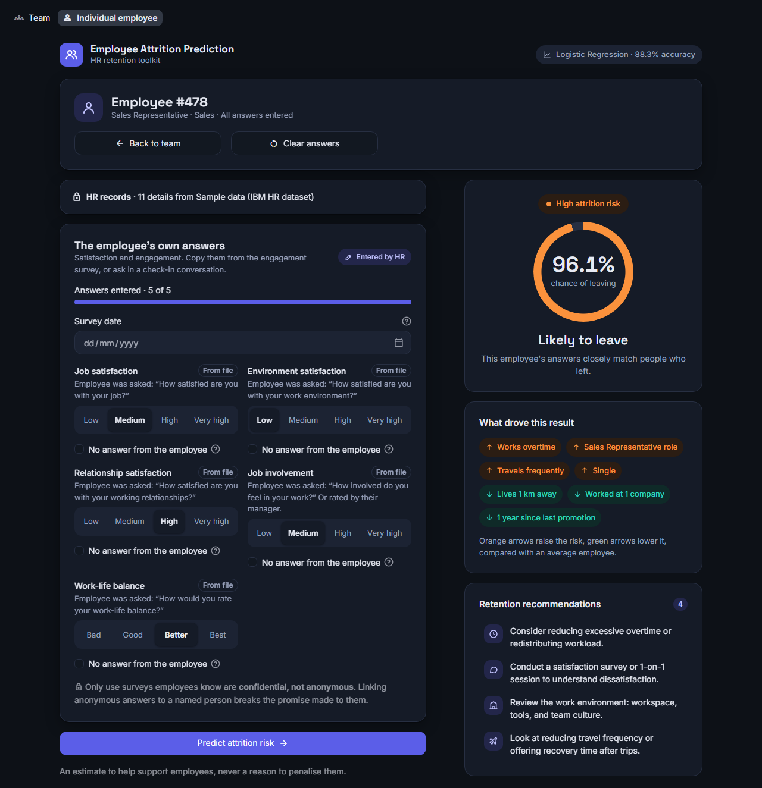
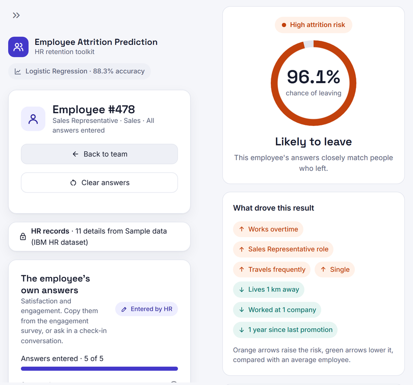

# 💼HR ANALYTICS FOR EMPLOYEE ATTRITION PREDICTION
[](https://attritionpredict.streamlit.app/)

🌐 **Live app:** [attritionpredict.streamlit.app](https://attritionpredict.streamlit.app/). Try it with the built-in sample data, no setup needed.

### 📸 Screenshots
**Team page:** upload your HR data and every employee is scored and ranked by risk.



**Individual employee:** HR enters the employee's survey answers and gets the prediction, what drove it, and retention recommendations.

| Light theme | Dark theme |
|---|---|
|  |  |

**On a phone:** the layout stacks into a single column.



### 📘Introduction:
HR Analytics leverages data-driven insights to improve workforce management. One critical application is predicting employee attrition—understanding why employees leave and identifying those at risk of leaving. This helps organizations retain talent, reduce turnover costs, and enhance productivity.
### ❓Problem Statement:
The goal is to develop a predictive model using employee data to identify individuals likely to leave the organization. By analyzing factors like job role, satisfaction, workload, and compensation, HR teams can take proactive steps to improve retention.
### 📊Data Acquisition
The data for the project is sourced from Kaggle and is made available to everyone. This information includes **1,470 records**, each containing **35 details** regarding employees. <br> 
> ✅ The dataset is already included in the repository: [HR-Employee-Attrition.csv](HR-Employee-Attrition.csv).
### 🔄 Preprocessing
The dataset has no missing values. Columns that are the same for every employee (EmployeeCount, Over18, StandardHours) and the EmployeeNumber ID are dropped. Categorical features are one-hot encoded and numeric features are scaled, inside a single scikit-learn pipeline, so the app applies exactly the same steps to new data.
### 🤖Model Development
We implemented and compared a range of machine learning models, including:
- **Logistic Regression**
- **Decision Tree**
- **Random Forest**
- **Support Vector Machine (SVM)**
- **XGBoost**
- **LightGBM**
- **CatBoost**
- **AdaBoost**
- **Gradient Boosting**

Each model was trained on the same dataset and tested using consistent evaluation metrics.
## 📈 Model Evaluation
To assess performance, we used the following metrics:
- **Accuracy**
- **Precision**
- **Recall**
- **F1-Score**
### 🏆Best Model Selection
Our first evaluation used a single 80/20 train/test split, where **Gradient Boosting** scored best (89.12%). However, the test set holds only 294 employees, so a single prediction changes accuracy by 0.34% and the ranking depends heavily on which employees land in the test set.

We therefore re-evaluated every model with **repeated stratified 5-fold cross-validation** (25 train/test rounds), which gives a much more reliable comparison. On this measure, **Logistic Regression** (with one-hot encoded categories and scaled numeric features) performed best:

| Model | Questions asked | Cross-validated accuracy | Leavers correctly identified |
|---|---|---|---|
| Gradient Boosting (previous) | 30 | 86.4% | 30% |
| **Logistic Regression (current)** | **16** | **88.3%** | **42%** |

> 🎯 **Accuracy: 88.3% (cross-validated)**, with about half the questions and 40% more at-risk employees identified.

### 🎯 Feature Selection
To keep the app short, we used **forward selection**: starting with no features, we repeatedly added the one that most improved cross-validated log-loss. Accuracy levels off after about 16 features, and asking all 30 adds no measurable accuracy. The 16 features used are:

- **Profile:** Age, Marital Status, Job Role, Distance from Home, Overtime, Business Travel
- **Career history:** Number of Companies Worked, Years in Current Role, Years with Current Manager, Years since Last Promotion, Training Sessions Last Year
- **Satisfaction & engagement:** Job Satisfaction, Environment Satisfaction, Relationship Satisfaction, Job Involvement, Work-Life Balance

Noise columns such as Daily Rate, Hourly Rate and Monthly Rate were never selected.

The training code is in [train_model.py](train_model.py), which saves the full pipeline (encoding, scaling and model) to `attrition_model.pkl`.
### 🚀 How to Run
Use the [live app](https://attritionpredict.streamlit.app/), or run it on your own computer:
```bash
python -m venv .venv
.venv\Scripts\activate            # Windows (macOS/Linux: source .venv/bin/activate)
pip install -r requirements.txt   # use requirements-dev.txt to also run the analysis scripts
python train_model.py             # creates attrition_model.pkl
streamlit run final_app.py
```
### 🧪Simulation Environment
- **IDE**: Visual Studio Code (VSCode) for development and debugging.
- **Frontend**: Built using **Streamlit** for its simplicity and fast deployment: [final_app.py](final_app.py). Deployed on Streamlit Community Cloud.
### 📁 Project Structure
| File | Purpose |
|---|---|
| [final_app.py](final_app.py) | The Streamlit app (Team and Individual employee pages) |
| [train_model.py](train_model.py) | Trains the final model and saves it to `attrition_model.pkl` |
| `attrition_model.pkl` | The trained pipeline used by the app |
| [accuracy_ceiling.py](accuracy_ceiling.py) | Reproduces the "Why not 95%+" results |
| [HR_Analytics.py](HR_Analytics.py) | Exploratory data analysis charts |
| [Gradient_Boosting.py](Gradient_Boosting.py) | The previous Gradient Boosting model, kept for comparison |
| [HR-Employee-Attrition.csv](HR-Employee-Attrition.csv) | The IBM HR dataset |
| [.streamlit/config.toml](.streamlit/config.toml) | Light and dark theme colours and fonts |
| `requirements.txt` / `requirements-dev.txt` | Packages for the app / for the analysis scripts |
| `screenshots/` | Images used in this README |
### 🛠️ App Features
The app has two pages, used in this order:

1. **Team** (the first page): upload a CSV exported from your HR system (a template is provided, and sample data is available to try). Every employee is scored and ranked by risk, with summary counts of high-risk, watch and low-risk employees, each person's key risk signals, and how many of their survey answers are known. Results can be downloaded as a CSV.
2. **Individual employee:** select someone in the Team table to open their assessment.
   - Their **HR records** (profile and career history) come from the file and sit in a collapsed, locked section, with a switch to correct a value if needed. The page opens on the part HR has to fill in.
   - HR enters **the employee's own answers** to the 5 satisfaction and engagement questions, copied from the engagement survey or asked in a check-in conversation. The employee never uses the app. Each question shows whether its answer is *Not in file*, *From file*, *Entered* or *No answer*, and an "Answers entered" bar tracks progress.
   - **Predict** shows the chance of leaving as an animated risk ring, compared with the employee's previous score in the Team table, plus **what drove the result** (the model is linear, so the app can show exactly which answers raised or lowered the risk compared with an average employee) and **retention recommendations** for high-risk employees.
   - The new score is saved back to the Team table, marked "Updated by HR", and a confirmation pops up. If HR changes an answer afterwards, the result is marked as out of date until they predict again. **Clear answers** undoes everything entered for that employee.

Before any data is uploaded, the Individual page works on its own as a blank form, for a quick one-off check.

**Where the answers come from:** 11 of the 16 questions come from standard HR records. The 5 satisfaction and engagement questions come from an engagement survey, and the app shows the exact survey question for each. If the employee didn't answer a question, HR can tick **No answer from the employee**: the app fills in the most common answer and warns that the result is less certain. It also flags survey answers that are over a year old.

**Using the model with another company's data:** the model learned its patterns from the IBM HR dataset (16% attrition, 9 job roles, a 1–4 survey scale). Another organisation's reasons for leaving, attrition rate, roles or survey scale may differ, so its predictions should be treated with care. For best results, retrain on that company's own history by running `train_model.py` on a CSV with the same columns plus an `Attrition` (Yes/No) column.

**Responsible use:** the app reminds HR to only use surveys employees know are confidential (not anonymous), and that predictions are for supporting employees, never for penalising them.

**Design:** separate light and dark themes, which follow the device setting by default and can be changed in the app menu (Settings › Choose app theme). The layout stacks into a single column on phones, and the animations turn off for users who have reduced motion enabled on their device.
## ❔Why does Logistic Regression beat Gradient Boosting here?
With only 1,470 employees, of whom just 237 left, there isn't enough data for tree ensembles to learn complex interactions without overfitting. The main attrition drivers (overtime, low satisfaction, short tenure, being single, frequent travel) each push the risk up or down fairly steadily, which is exactly the pattern Logistic Regression models well. One-hot encoding also lets it learn a separate effect for each job role, instead of treating the label-encoded roles as an ordered number. As a bonus, Logistic Regression is fast and its predictions are easy to explain to HR.

## 📉 Why not 95%+ accuracy?
Some projects on this dataset report 95–99% accuracy. We tried to get there and found that **about 89% is the honest limit** for this data. Higher numbers almost always come from a flaw in how the model was tested.

### What we tried
Every result below was measured with cross-validation, so the model is always tested on employees it never saw during training.

| Approach | Accuracy |
|---|---|
| No model: always predict "stays" | 83.9% |
| Logistic Regression, all 30 features | 88.5% |
| + 7 engineered features (income per job level, years per company, combined satisfaction score, …) | 89.0% |
| + tuned decision threshold | 89.0% |
| + stacking Logistic Regression, SVM and CatBoost | 89.0% |

Engineered features add about half a point, and the remaining techniques add nothing: accuracy levels off at 89%. The app uses the simpler 16-feature model (88.3%) because the extra 0.7% would cost 14 more questions and a much more complex model.

### Why the limit is around 89%
1. **The data doesn't record the real reasons for leaving.** People leave because of a job offer elsewhere, a family move, a bad manager, burnout or a better salary elsewhere, and none of these appear in the data. Two employees can have identical values for all 30 features while one leaves and one stays, and no model can tell them apart.
2. **The dataset is small and imbalanced.** There are only 1,470 employees, and just 237 (16%) left. That isn't enough examples for a model to learn rare or subtle patterns reliably.
3. **Some features are noise.** Daily Rate, Hourly Rate and Monthly Rate have no relationship with attrition, and our feature selection never picked them.

### How inflated accuracy numbers happen
We reproduced the two most common mistakes with the same data:

| Evaluation method | Reported accuracy |
|---|---|
| Oversampling leavers (e.g. with SMOTE) **before** the train/test split | 98.4% ❌ |
| Testing on the same data the model was trained on | 100% ❌ |
| **The same Random Forest, tested correctly** | **85.8%** ✅ |

Oversampling before splitting puts copies of the same employee in both the training and test sets, so the model is graded on people it has already seen. The score looks impressive, but it says nothing about how the model will perform on a new employee. Oversampling is only valid if it is applied to the training data after the split.

### Accuracy isn't the whole story
Because 84% of employees stay, a "model" that always predicts "stays" already scores 83.9%, while identifying no one at risk. A better question is **how many leavers the model identifies**. Our model identifies 42% of them, compared with 30% for the previous Gradient Boosting model and 0% for the do-nothing baseline. For HR, finding more at-risk employees matters more than an extra point of accuracy.

### What would actually improve the model
- **Better data**: engagement survey trends, recent manager changes, performance rating history, pay compared with the market, and time since the last raise
- **More data**: thousands of employees rather than 1,470, ideally from the real organisation
- **Tuning for recall**: lowering the decision threshold so the model flags more at-risk employees, at the cost of some false alarms

All results in this section can be reproduced with [accuracy_ceiling.py](accuracy_ceiling.py).
